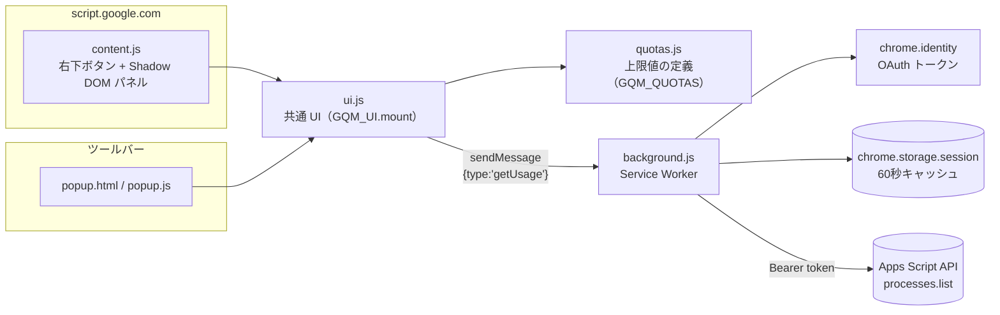

# ⏱ GAS Quota Meter


Google Apps Script（GAS）の **割り当て（Quota）の上限** と **直近24時間の使用量** を、Apps Script エディタ上でそのまま確認できる Chrome 拡張機能です。

「トリガーが急に止まった」「今日あと何分トリガーを回せる？」といった疑問に、エディタを離れずに答えます。

---

## 目次

- [主な機能](#主な機能)
- [表示される内容](#表示される内容)
- [仕組み](#仕組み)
- [セットアップ](#セットアップ)
- [うまく動かないとき](#うまく動かないとき)
- [ファイル構成とコード解説](#ファイル構成とコード解説)
- [権限とプライバシー](#権限とプライバシー)
- [制限事項](#制限事項)

---

## 主な機能

- **エディタ内ボタン** — script.google.com の右下に「⏱ Quota xx%」ボタンを表示。クリックでパネルが開きます
- **ツールバーのポップアップ** — 拡張機能アイコンからも同じ内容を確認できます
- **使用率の色分け** — トリガー実行時間が 80% 以上でオレンジ、100% 以上またはタイムアウト発生で赤
- **無料 / Workspace の切り替え** — アカウント種別に応じて上限値を切り替え（設定は `chrome.storage.sync` に保存）
- **自動更新** — パネルを開いている間は 2 分ごとに再取得（↻ で手動更新）
- **ダークモード対応** — `prefers-color-scheme` に追従
- **ビルド不要** — 素の JavaScript だけで構成。フォルダを読み込むだけで動きます

## 表示される内容

| 項目 | 取得元 |
|---|---|
| トリガーの合計実行時間（無料 90分 / Workspace 6時間） | Apps Script API で算出 |
| 実行回数・失敗・タイムアウト・最長実行時間（上限6分） | Apps Script API で算出 |
| 実行中の数（同時実行の上限30） | Apps Script API で算出 |
| プロジェクト別の回数・トリガー時間・失敗数（上位8件） | Apps Script API で算出 |
| 最近の失敗（最新5件） | Apps Script API で算出 |
| 枠が空き始める時刻（最も古いトリガー実行が24時間枠から外れる時刻） | Apps Script API で算出 |
| メール・URL Fetch・ドキュメント作成などの1日の上限 | 上限値のみ表示（`quotas.js`） |

> [!NOTE]
> Google はメール送信数や URL Fetch 回数などの使用量を API で公開していないため、これらは上限値のみの表示です。
> メールの残数はスクリプト内で `MailApp.getRemainingDailyQuota()` を呼ぶと確認できます。

---

## 仕組み

### 全体構成



エディタ内パネルとポップアップは同じ `ui.js` を使い、データ取得はすべて Service Worker（`background.js`）に集約しています。

### データ取得の流れ

1. UI が `chrome.runtime.sendMessage({ type: 'getUsage' })` を送信
2. `background.js` が `chrome.storage.session` のキャッシュを確認（60秒以内ならそれを返す）
3. `chrome.identity.getAuthToken` でアクセストークンを取得
4. [`processes.list`](https://developers.google.com/apps-script/api/reference/rest/v1/processes/list) を `userProcessFilter.startTime = 24時間前` で呼び出し、`nextPageToken` をたどって全件取得（50件 × 最大40ページ = 2000件）
5. 401 が返ったらキャッシュ済みトークンを破棄して **1回だけ** 再取得・再試行
6. `aggregate()` で集計し、キャッシュに保存して UI に返却

### 集計ロジック（`aggregate()`）

| 集計値 | 算出方法 |
|---|---|
| 実行時間 | `duration`（例: `"12.345s"`）を秒に変換。実行中のものは `現在時刻 − startTime` |
| トリガー実行時間 | `processType` が `TIME_DRIVEN` / `TRIGGER` / `SIMPLE_TRIGGER` のものだけを合算 |
| 失敗 | `processStatus` が `FAILED` または `TIMED_OUT` |
| 実行中 | `processStatus` が `RUNNING` |
| 最長実行 | 全プロセスの中で実行時間が最大のもの |
| 枠が空く時刻 | 最も古いトリガー実行の開始時刻 + 24時間 |

> [!TIP]
> GAS の割り当ては「日付が変わるとリセット」ではなく「**最初の実行から24時間で回復**」する仕組みです。
> そのため本拡張機能は暦日ではなく **直近24時間のローリングウィンドウ** で集計しています。

### エラー判定

API のレスポンスを `QuotaError` に変換し、`code` に応じて UI が案内を出し分けます。

| code | 条件 | UI の動作 |
|---|---|---|
| `AUTH` | トークン取得失敗 / 401 | 「Google でログイン」ボタンを表示 |
| `SETUP` | OAuth クライアント ID の誤り | manifest.json の設定手順を案内 |
| `API_DISABLED` | 403 かつ Apps Script API 無効 | ユーザー設定 or GCP プロジェクトの有効化を案内 |
| `API` | その他の API エラー | メッセージと「再試行」ボタン |

---

## セットアップ

### 1. 拡張機能を読み込む

1. Chrome で `chrome://extensions` を開き、右上の「デベロッパー モード」をオンにする
2. 「パッケージ化されていない拡張機能を読み込む」でこの `gas-quota-meter` フォルダを選ぶ
3. 表示された **拡張機能 ID**（32文字の英字）をメモする

> [!IMPORTANT]
> 拡張機能 ID はフォルダの場所で決まります。フォルダを移動すると ID が変わるので、置き場所を決めてから読み込んでください。

### 2. OAuth クライアント ID を作る（Google Cloud Console）

1. <https://console.cloud.google.com/> でプロジェクトを作成（既存でも可）
2. 「API とサービス」→「ライブラリ」で **Apps Script API** を有効にする
3. 「OAuth 同意画面」を設定する（Workspace アカウントなら種類は「内部」で可）
   - スコープに `https://www.googleapis.com/auth/script.processes` を追加
4. 「認証情報」→「認証情報を作成」→「OAuth クライアント ID」
   - アプリケーションの種類: **Chrome 拡張機能**
   - アイテム ID: 手順1でメモした拡張機能 ID
5. 作成されたクライアント ID をコピー

### 3. manifest.json に設定する

`manifest.json` の `oauth2.client_id` を手順2のクライアント ID に置き換え、`chrome://extensions` でこの拡張機能の再読み込みボタンを押します。

```json
"oauth2": {
  "client_id": "XXXXXXXXXXXX-xxxxxxxxxxxxxxxx.apps.googleusercontent.com",
  "scopes": ["https://www.googleapis.com/auth/script.processes"]
}
```

> リポジトリに含まれているクライアント ID は作者の環境（拡張機能 ID）用です。別の環境で使う場合は必ず自分で作成したものに置き換えてください。

### 4. Apps Script API をユーザー設定でオンにする

<https://script.google.com/home/usersettings> で「Google Apps Script API」をオンにします。

### 5. 使う

script.google.com を開き、右下のボタン →「Google でログイン」で権限を許可すると表示されます。

---

## うまく動かないとき

| 表示 | 対処 |
|---|---|
| OAuth クライアントIDが正しく設定されていません | 手順2〜3。クライアントの種類が「Chrome 拡張機能」で、ID が一致しているか確認 |
| Apps Script API がユーザー設定でオフになっています | 手順4 |
| GCP プロジェクトで Apps Script API が有効になっていません | 手順2-2 |
| ログイン画面で拒否される | 会社の Workspace 管理者が外部アプリや API を制限している可能性があります |
| 拡張機能と通信できませんでした | `chrome://extensions` で拡張機能を再読み込みし、ページもリロード |

---

## ファイル構成とコード解説

```
gas-quota-meter/
├── manifest.json     拡張機能の設定（Manifest V3）
├── background.js     Service Worker：認証・API 呼び出し・集計・キャッシュ
├── quotas.js         割り当て・上限値の一覧（GQM_QUOTAS）
├── ui.js             共通 UI（GQM_UI）
├── content.js        script.google.com に右下ボタンとパネルを追加
├── popup.html        ツールバーのポップアップ
├── popup.js          ポップアップに UI をマウント
└── icons/            アイコン（icon.svg が元データ。16/32/48/128px の PNG はこれから書き出し）
```

### `manifest.json`
Manifest V3。権限は `identity`（OAuth）と `storage`（キャッシュ・設定）のみで、ホスト権限は `script.googleapis.com` に限定しています。content script は `quotas.js → ui.js → content.js` の順で読み込まれ、グローバル変数 `GQM_QUOTAS` / `GQM_UI` を共有します。

### `background.js`
| 関数 | 役割 |
|---|---|
| `getToken(interactive)` | `chrome.identity.getAuthToken` のラッパー。エラーメッセージから「クライアント ID の誤り」か「未ログイン」かを判別 |
| `toApiError(res)` | API エラーレスポンスを `QuotaError`（`code` / `hint` 付き）に変換 |
| `fetchProcesses(token, since)` | `processes.list` をページングしながら全件取得。2000件で打ち切り |
| `aggregate(...)` | 取得したプロセス一覧を集計し、UI 用のオブジェクトを返す |
| `getUsage({force, interactive})` | キャッシュ確認 → 取得 → 集計 → 保存。トークン失効時は1回だけリトライ |
| `signOut()` | キャッシュ済みトークンを削除し、`oauth2.googleapis.com/revoke` で失効させる |

### `quotas.js`
公式ドキュメントの上限値を `daily`（1日あたりの割り当て、`consumer` / `workspace` の2値）と `limits`（実行時間・同時実行数などの固定上限）に分けて定義しています。`measurable: true` の項目だけが API から使用量を算出できます。**Google が上限値を変更したらこのファイルだけを修正すれば OK** です。

### `ui.js`
`GQM_UI.mount(root, { onData })` でパネルを描画する共通モジュール。状態（`plan` / `data` / `error` / `loading` / `showLimits`）を持ち、変更のたびに HTML 文字列を再生成するシンプルな構成です。

- イベントは `data-action` 属性によるイベント委譲で処理（`refresh` / `login` / `limits` / `plan` / `signout`）
- 表示する文字列はすべて `esc()` で HTML エスケープ
- `onData(data, plan)` コールバックで、取得結果を呼び出し元（content.js のボタン表示）に通知

### `content.js`
script.google.com のページに固定配置のボタンを追加します。**Shadow DOM** の中に描画するため、エディタ側の CSS と互いに干渉しません。パネルを開いている間だけ 2 分間隔の自動更新タイマーを動かし、`Esc` キーで閉じられます。

### `popup.html` / `popup.js`
`#app` に `GQM_UI.mount()` するだけの薄いエントリーポイントです。

---

## 権限とプライバシー

| 権限 | 用途 |
|---|---|
| `identity` | Google アカウントの OAuth トークン取得 |
| `storage` | 取得結果の一時キャッシュ（`session`）と、無料 / Workspace の選択（`sync`） |
| `https://script.googleapis.com/*` | Apps Script API の呼び出し |
| OAuth スコープ `script.processes` | **実行履歴の読み取りのみ**。スクリプトの内容の閲覧・変更はできません |

取得したデータはブラウザ内でのみ扱い、外部サーバーへ送信することはありません。

---

## 制限事項

- `chrome.identity.getAuthToken` を使うため **Chrome 専用** です（Edge では動作しません）
- 1日に 2000 件を超える実行がある場合、集計は 2000 件で打ち切られます（フッターに表示）
- メール・URL Fetch などの使用量は API 非公開のため表示できません
- 上限値は[公式ドキュメント](https://developers.google.com/apps-script/guides/services/quotas)に基づいていますが、変更されることがあるため定期的に確認してください
